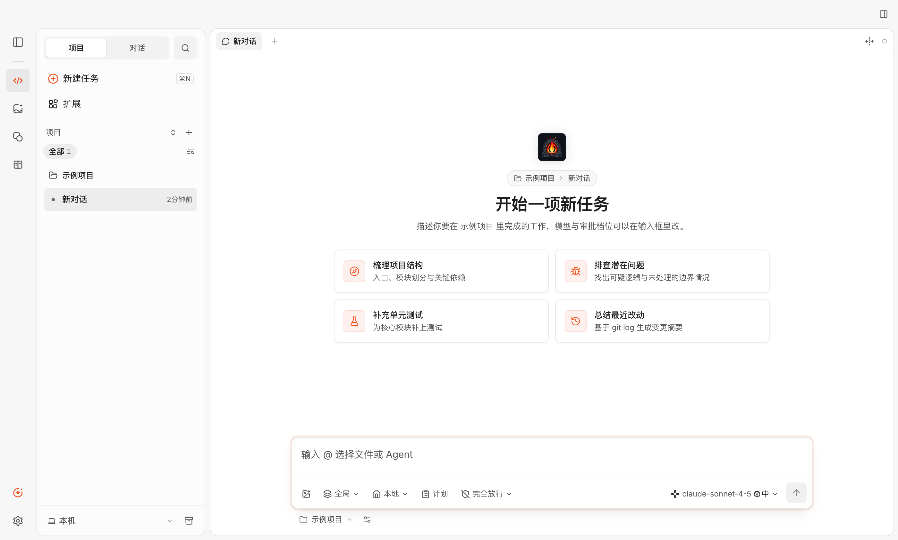
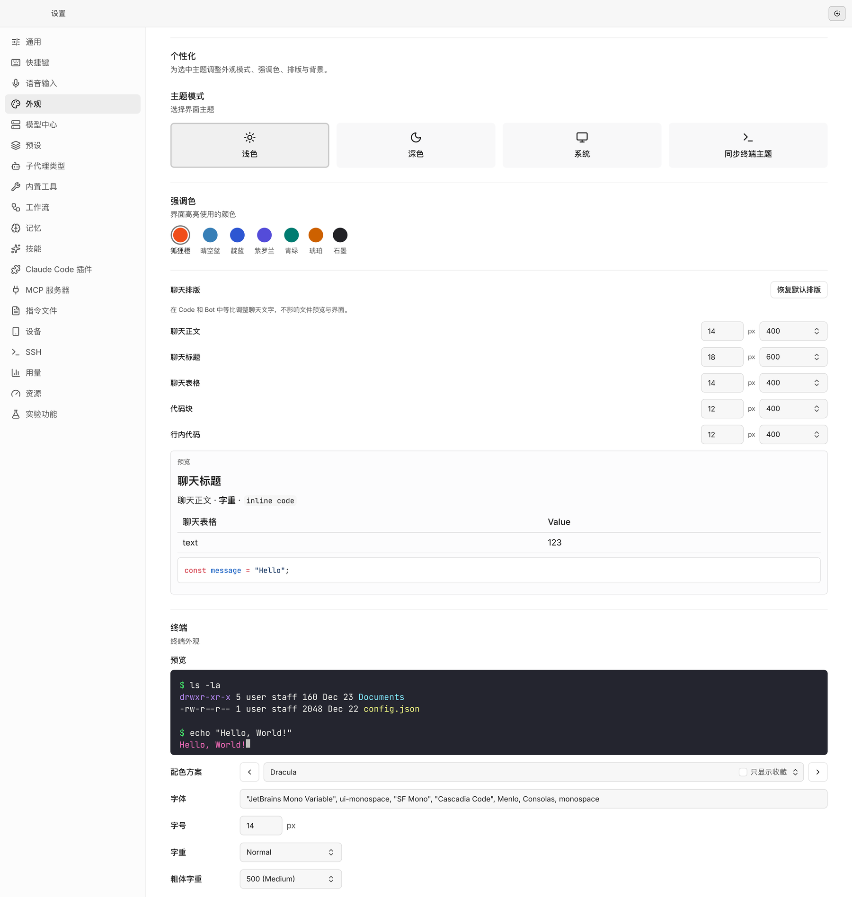
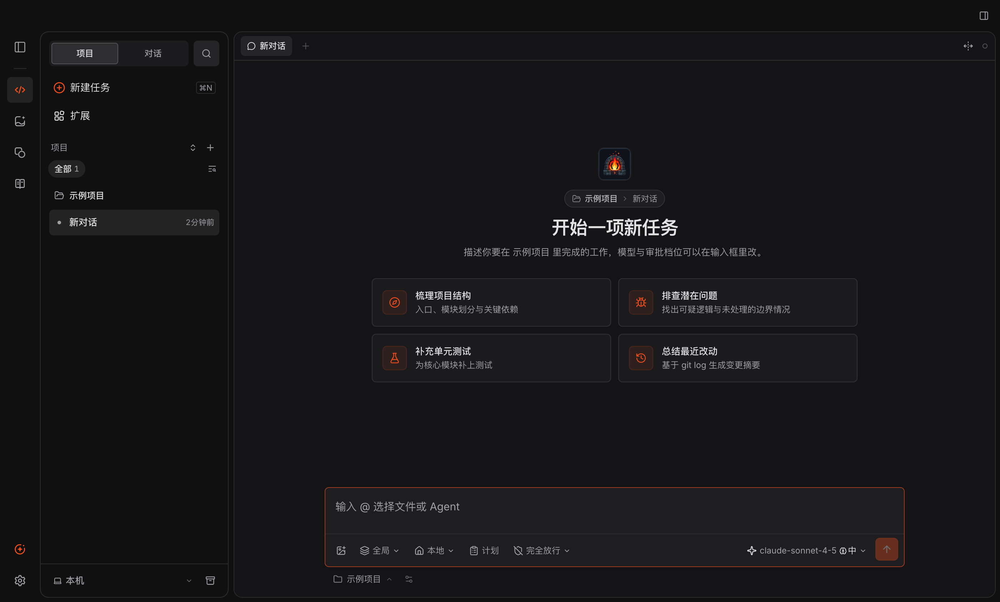

<p align="center">
  
</p>

<h1 align="center">CodeKiln</h1>

<p align="center">
  <b>Your projects, models, and coding agents — one desktop workspace.</b>
</p>

<p align="center">
  A local-first coding agent workbench, independently maintained by
  <a href="https://github.com/tingyuxuan123">@tingyuxuan123</a>.
</p>

<p align="center">
  <a href="https://github.com/tingyuxuan123/EnsoCode/releases"><b>Download</b></a>
  ·
  <a href="#what-it-does">Features</a>
  ·
  <a href="#built-in-tools">Tools</a>
  ·
  <a href="#development">Development</a>
  ·
  <a href="https://github.com/tingyuxuan123/EnsoCode/issues">Feedback</a>
  ·
  <a href="README.zh-CN.md">简体中文</a>
</p>

<p align="center">
  <a href="https://github.com/tingyuxuan123/EnsoCode/releases"></a>
  
  <a href="LICENSE"></a>
</p>

---

<p align="center">
  
</p>
<p align="center"><sub>The current workspace in light mode: project navigation and a new task, using an isolated sample project.</sub></p>

## Contents

- [About this version](#about-this-version)
- [What it does](#what-it-does)
- [Built-in tools](#built-in-tools)
- [Wiki memory](#wiki-memory)
- [Mobile devices and remote work](#mobile-devices-and-remote-work)
- [Download and get started](#download-and-get-started)
- [Local-first, with clear boundaries](#local-first-with-clear-boundaries)
- [Development](#development)
- [Feedback and contributions](#feedback-and-contributions)
- [Acknowledgements and license](#acknowledgements-and-license)

## About this version

This repository started as a fork of [J3n5en/EnsoCode](https://github.com/J3n5en/EnsoCode) and is now independently maintained here as CodeKiln. It builds on the original project, with its own interface, development priorities, and personal release channel. It is **not an official upstream distribution**.

The product name is now CodeKiln, and this rename is complete rather than cosmetic: the app id is `com.j3n5en.codekiln`, the package name is `codekiln`, and pairing and plugin-install links use `codekiln://`. Because the app id changed, an older build will not auto-update into this one: install it once by hand.

What deliberately keeps the old identifiers:

- The desktop data directory is still `enso-code` (`enso-code-dev` in development). Saved sessions and workspace records point at absolute paths inside it, so the name is frozen on purpose; your existing conversations and settings stay where they are.
- The GitHub repository name, the personal signing certificate, the plugin API namespace (`enso-plugin.json`, `Enso*` types), and the local storage keys are unchanged.

Two things do need attention when switching from an upstream build: API keys kept in the macOS keychain are stored per bundle name and must be entered again, and third-party plugin install links written as `enso://install-plugin?…` must be rewritten to `codekiln://`.

The focus is a workspace you can use every day: move between projects and conversations, choose the right model, delegate work, and review the result without scattering everything across separate windows.

Built with Electron, React, TypeScript, and the [pi](https://github.com/earendil-works/pi) coding agent harness.

## What it does

### A conversation with the tools beside it

The workspace brings project navigation, the conversation timeline, and dockable tool panels together. Open files, inspect changes, run a terminal, or check a page in the embedded browser while keeping the task in view.

- **Projects & sessions** — organize work by repository and keep separate conversations for separate tasks.
- **Files & changes** — browse source files and review session or Git changes next to the conversation.
- **Terminal & browser** — run commands and preview web work without leaving the app.
- **Appearance** — light and dark themes, terminal palettes, background images, and opacity settings.
- **Search** — jump to any project, session, file, or setting from a single search box.

<details>
<summary><strong>Appearance settings</strong></summary>

<p align="center">
  
</p>
<p align="center"><sub>Theme modes, accent colors, and a live terminal palette preview.</sub></p>

</details>

### Choose models and reuse your setup

Connect your own providers and endpoints rather than committing to one model service. Configure models, skills, MCP servers, and runtime presets for the way you work.

- Import supported local configuration and history from Claude Code, Codex, and Cursor.
- Reference files and sessions with `@`, and use skills and slash commands in the composer.
- Keep model selection and context usage visible while you work.
- Switch the model for a coworker session by hand and continue with the context already gathered.
- Approval modes range from reviewing every tool call to accepting edits automatically to full access; pick a reviewer model for approvals when you want a second opinion.
- Voice input is available where the platform supports it.

### Delegate without losing the thread

| Tool | Use it for |
| :--- | :--- |
| **Subagents** | Self-contained research, implementation, testing, or review in a separate context. |
| **Coworkers** | Longer collaboration in a separate session you can inspect and steer. |
| **Workflows** | Repeatable multi-agent tasks, with presets and a panel for run progress. |
| **Goal tracking** | Keep an outcome in view while the agent works through multiple turns. |
| **Background tasks** | Keep dev servers, watchers, and long-running commands separate from the main conversation. |

Git worktrees are available for tasks that need separate working trees. Separate agent contexts alone do not isolate concurrent file edits.

<p align="center">
  
</p>
<p align="center"><sub>The same task workspace in dark mode. Workflow presets are available from the side panel.</sub></p>

Screenshots use an isolated local preview without private conversations or provider credentials; no model run is shown.

### Review and stay in control

Review diffs, approve tool actions, queue follow-ups, or interrupt a running task. Approval modes let you choose between manual review, automatically accepting edits, and full access. Git checkpoints provide a way to rewind supported changes.

The icon rail on the left is the app switcher. Beyond **Code**, it holds the **image studio**, the **design gallery**, the **Wiki**, **Ask CodeKiln**, and **Settings**. Each module has its own sessions and artifacts without hiding the main conversation.

## Built-in tools

Every tool below can be switched on or off in **Settings → Built-in tools**. A disabled tool is not sent to the session at all, so the model cannot see it. `Computer` and `Code search` are off by default because they are hard to take back or send code off the machine.

| Tool | What it does |
| :--- | :--- |
| **Subagent / Coworker** | Delegate a one-shot task or keep a persistent collaborator under Main control. |
| **Workflow** | Run a JavaScript workflow that fans work out across subagents, with live status in the side panel. |
| **Todo** | Track progress across multi-step work. |
| **Plan mode** | Research read-only, submit a plan for approval, then execute it. |
| **Ask user** | Ask you a question and wait, with options and a timeout. |
| **Browser** | Drive CodeKiln's own Chromium: read snapshots, click and type by element reference. |
| **Design** | Create and verify standalone UI design documents on a canvas. |
| **Web search** | Search with the session model's built-in search, falling back to a keyless service, and read pages as markdown. |
| **Code search** | Search workspace code through a cloud-assisted index. Off by default; sends the query and selected code. |
| **Image generation** | Generate and edit images through an OpenAI-compatible image service you configure separately. |
| **Background tasks** | Run long commands in the background and get notified on completion. |
| **Script orchestration** | Batch tool calls in JavaScript and filter results before they enter the conversation. |
| **Computer** | Drive the host desktop: list windows, screenshot, read accessibility trees, send input. Off by default. |
| **Mobile devices** | Use the emulators, simulators, and phones attached to this host. |

### Image generation

Image generation has its own connection settings — an OpenAI-compatible endpoint and key stored encrypted on this machine, kept apart from your chat providers. Configure text-to-image and image-to-image models independently, test the connection, and pull the model list. Generated images land in the session working directory and are shown inline; the image studio (icon rail) is a separate workspace for dedicated image sessions. Nothing is charged until you send a request.

### Design canvas

The design gallery hosts editable `.vetd` design documents rendered from TSX sources, with frame sizes, shared UI, screenshots, exports to PDF or PNG, and a version history you can restore. The agent can drive it through the design tools, but only inside a design that is actually open, and every file access is validated by the Main process.

## Project knowledge

Install the optional [Knowledge Map extension](examples/plugins/llmdoc/README.md) to browse and search project knowledge, find the documents affected by code changes, and start an explicit maintenance workflow in a local Git project. Agents can query the same documents on demand. Maintenance presents a preview and requires approval before writing or committing; the extension does not compile conversations.

The built-in Wiki has been removed. Existing Wiki files and chat history are not migrated or deleted. You can still open old Markdown files directly.

## Mobile devices and remote work

For work away from the desk, the project also includes an optional phone companion, paired desktop remote nodes, and SSH projects. Phone and remote-node pairing use end-to-end encryption; a relay forwards ciphertext rather than conversation plaintext.

- **Android client** — a native Kotlin/Compose app in [`android/`](android/README.md): pair one desktop, create text tasks, follow sessions, answer approvals and questions, send text or images, queue and interrupt, manage goals, browse the session status board, and download session artifacts.
- **Phone web app** — a paired web surface in [`packages/phone`](packages/phone).
- **Desktop remote nodes** — connect another desktop as a node, or take over this one from a paired client.
- **Mobile device panel** — drive Android emulators, Android devices, iOS simulators, and iPhones attached to this machine, including letting the agent operate a device after you grant it for one conversation. Setup and limits are in [docs/mobile-devices.md](docs/mobile-devices.md).
- **Self-hosted relay** — optional infrastructure in [`packages/relay`](packages/relay/README.md) and [`packages/relay-go`](packages/relay-go) if you would rather not depend on a shared relay.

## Plugins

Native plugins are directories with an `enso-plugin.json` manifest; installing copies them into the app's private data directory. They can add commands, tools, composer actions, sidebar views, and theme or layout changes through documented host interfaces — not by reaching into internal components. The API namespace keeps the `enso.*` prefix. See [docs/plugins.md](docs/plugins.md) for the manifest, permissions, and the local template commands (`pnpm plugin:init`, `plugin:validate`, `plugin:pack`).

Claude Code plugins are managed separately in the same settings page; the two kinds do not replace each other.

## Download and get started

**[Browse this repository’s releases →](https://github.com/tingyuxuan123/EnsoCode/releases)**

Two channels are published from this repository:

| Channel | Tag | Platform | Status |
| :--- | :--- | :--- | :--- |
| Personal update | `personal-v*` | macOS Apple Silicon, `.dmg` + `.zip` | Prerelease; does not change Latest |
| Windows | `windows-v*` | Windows x64, NSIS installer | Public release, promoted to Latest after CI verification |

Linux and Intel Mac build support exists in the source tree, but this repository does not publish maintained binaries for those platforms.

1. Download the installer from a release in **this repository**.
2. Open Settings and connect a model provider, or import a supported local setup.
3. Add a project and start a conversation.
4. Describe the task, review the proposed actions, and inspect the resulting changes.

No CodeKiln account is required. Model requests go to the provider or endpoint you configure, and any usage charges belong to that service.

### Personal updates

Personal builds use this repository’s `personal-updates` channel. An upstream installation does not automatically switch to it; the initial migration requires a manual installation of a personal build. Back up important settings and sessions before switching distributions.

These builds use a personal signing certificate, **not Apple Developer ID notarization**. macOS may require additional confirmation. Check the release notes and `SHA256SUMS` before installing; do not disable system security globally.

### Windows builds

The Windows installer is built and verified by CI on a Windows runner, then published automatically once its hashes, bundled native dependencies, and update manifest pass. Installation, upgrade from an older version, and retention of existing settings and sessions are **not** covered by that automated check — verify them on your own machine after installing.

### Update verification

Personal builds download updates from this repository's `personal-updates` branch and verify the published manifest and hashes before installing. Release notes are shown before you install; they are rendered as untrusted content, and links open in your system browser. The app never force-restarts to install an update — you choose when to restart, and the previous application and your user data are kept.

## Local-first, with clear boundaries

| Data or action | Boundary |
| :--- | :--- |
| Conversations and settings | Stored locally by the app. |
| Provider credentials | Managed by the desktop Main process, not included in the phone catalog. |
| Model requests | Sent to your configured provider or endpoint, including the context needed for the request. |
| MCP and external tools | May access files or services according to their configuration and the permissions you grant. |
| Phone and remote nodes | Optional pairing; relayed session traffic is end-to-end encrypted. |
| Browser and network tools | Contact the sites and services you open or ask the agent to use. |
| Wiki memory | Markdown files on disk; an attached external vault stays where you put it. |
| Desktop and device control | Off by default or granted per conversation; every action is visible in the timeline. |

Local-first does not mean offline-only. Choose providers, tools, and remote services according to your own privacy requirements.

## Development

Use the Node.js version in [`.nvmrc`](.nvmrc) and the pnpm version pinned in [`package.json`](package.json).

```bash
pnpm install
pnpm dev
```

```bash
# Build the application bundles
pnpm build

# Checks before submitting changes
pnpm typecheck && pnpm lint && pnpm test
```

`pnpm dev` also prepares the bundled helpers (RTK, design engine, device helpers); `pnpm build` does the same after Vite finishes. Android work lives in [`android/`](android/README.md) and additionally runs `./gradlew check` there.

Repository layout:

| Path | Contents |
| :--- | :--- |
| `src/agent/` | Worker-side agent runtime and tool implementations. |
| `src/main/` | Electron Main process: IPC, services, updater, memory, devices. |
| `src/preload/` | Typed bridge exposed to the renderer. |
| `src/renderer/` | React UI: chat, panels, settings, and the design, wiki, device, and image features. |
| `src/shared/` | Types, i18n, and pure logic shared across layers. |
| `packages/` | Pairing protocol, phone web app, and relay servers. |
| `android/` | Native Android client. |
| `scripts/` | Build, release, verification, and maintenance scripts. |
| `docs/` | Engineering guidelines, subsystem guides, and release documentation. |

Documentation worth reading before a change:

- [Engineering guidelines](docs/engineering-guidelines.md) — conventions, testing, and layer boundaries.
- [Release & update guide](docs/engineering-reference/guides/releasing.md) — personal builds are packaged and verified by GitHub Actions, not locally.
- [Design subsystem](docs/engineering-reference/guides/design-subsystem.md) — design authority and execution boundaries.
- [Mobile devices](docs/mobile-devices.md) — device prerequisites and the permission model.
- [Plugins](docs/plugins.md) — native plugin manifest, permissions, and local templates.
- [Self-hosting the relay](packages/relay/README.md) — optional infrastructure for paired devices.

## Feedback and contributions

Use [Issues in this repository](https://github.com/tingyuxuan123/EnsoCode/issues) for bugs and suggestions about this version. Include the app version, operating system, reproduction steps, and relevant redacted logs. Never post API keys, pairing secrets, or private conversation content.

This is a personally maintained project. Development follows the maintainer’s own usage and priorities; upstream features and releases may differ. For substantial contributions, discuss the scope in an issue first and keep pull requests focused.

## Acknowledgements and license

Thanks to [J3n5en/EnsoCode](https://github.com/J3n5en/EnsoCode) and its contributors for the original project, and to [pi](https://github.com/earendil-works/pi) and the open-source projects this workbench builds on.

Released under the [GNU Affero General Public License v3.0](LICENSE). The mobile-device host, drivers and panel are ported from [Kettu](https://github.com/KettuAI/Kettu) (AGPL-3.0-only), so this project as a whole is now distributed under AGPL-3.0. Original copyright and license notices are preserved; see [Third-party notices](THIRD_PARTY_NOTICES.md).
