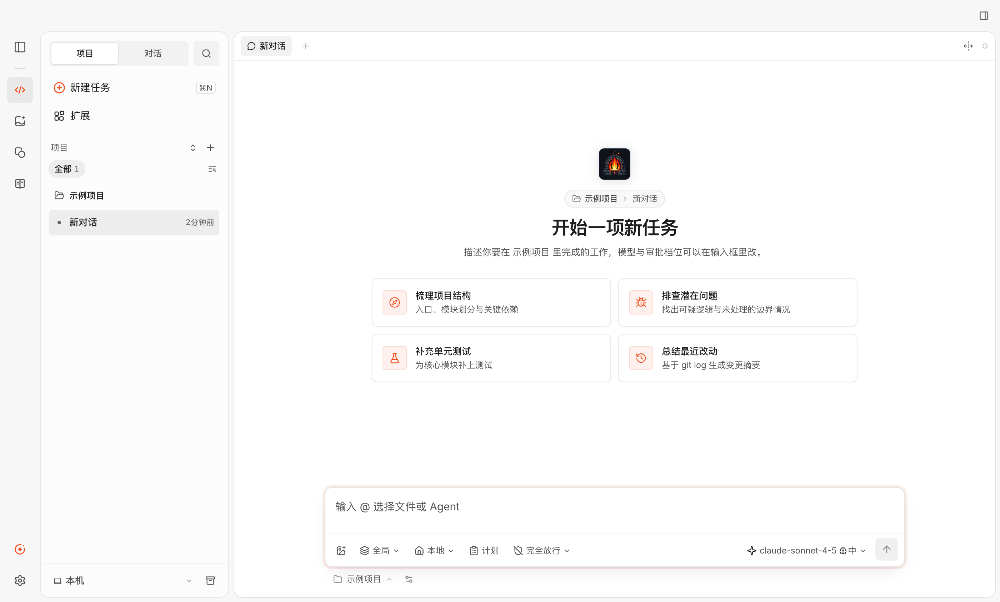
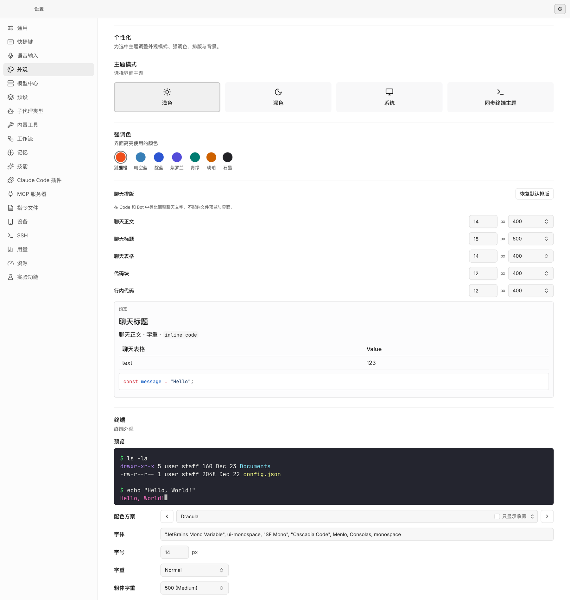
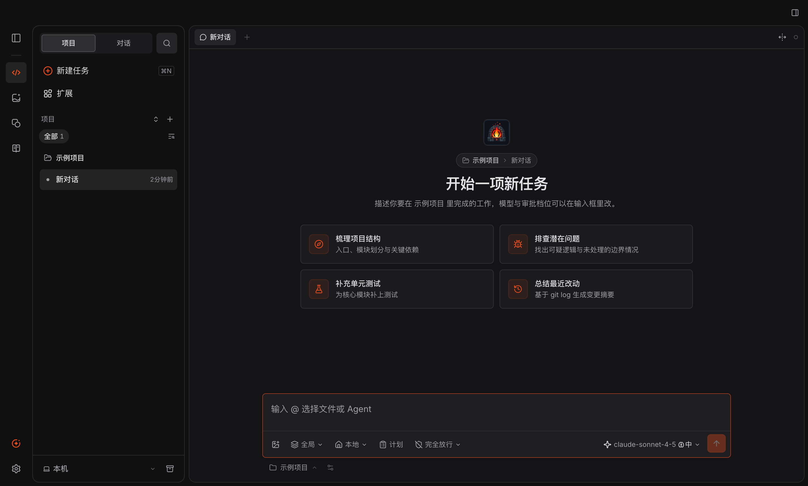

<p align="center">
  
</p>

<h1 align="center">CodeKiln</h1>

<p align="center">
  <b>把项目、模型和 Coding Agent，放进同一个桌面工作台。</b>
</p>

<p align="center">
  本地优先的编程 Agent 工作台，由
  <a href="https://github.com/tingyuxuan123">@tingyuxuan123</a> 独立维护。
</p>

<p align="center">
  <a href="https://github.com/tingyuxuan123/EnsoCode/releases"><b>下载</b></a>
  ·
  <a href="#工作台能做什么">功能介绍</a>
  ·
  <a href="#内置工具">工具一览</a>
  ·
  <a href="#本地开发">本地开发</a>
  ·
  <a href="https://github.com/tingyuxuan123/EnsoCode/issues">问题反馈</a>
  ·
  <a href="README.md">English</a>
</p>

<p align="center">
  <a href="https://github.com/tingyuxuan123/EnsoCode/releases"></a>
  
  <a href="LICENSE"></a>
</p>

---

<p align="center">
  
</p>
<p align="center"><sub>当前浅色工作台：使用隔离示例项目展示项目导航与新任务。</sub></p>

## 目录

- [关于这个版本](#关于这个版本)
- [工作台能做什么](#工作台能做什么)
- [内置工具](#内置工具)
- [Wiki 记忆](#wiki-记忆)
- [移动设备与远程协作](#移动设备与远程协作)
- [下载与开始使用](#下载与开始使用)
- [本地优先，但不模糊联网边界](#本地优先但不模糊联网边界)
- [本地开发](#本地开发)
- [反馈与参与](#反馈与参与)
- [致谢与许可](#致谢与许可)

## 关于这个版本

本仓库起源于 [J3n5en/EnsoCode](https://github.com/J3n5en/EnsoCode)，现在以「CodeKiln」为名由我独立维护。在原项目基础能力之上，这个版本按自己的使用习惯持续调整界面、交互和开发方向，并使用独立的个人发布通道。**它不是上游官方发行版。**

产品现名「CodeKiln」，而且这次是完整改名：应用 ID 为 `com.j3n5en.codekiln`、包名 `codekiln`、配对与插件安装协议 `codekiln://`。因为应用 ID 变了，旧版不会自动升级到这一版，需要手动安装一次。

有意保留旧标识的部分：

- 桌面数据目录仍然是 `enso-code`（开发环境为 `enso-code-dev`）。已保存的会话和工作区记录引用着该目录下的绝对路径，所以目录名是刻意冻结的，你原有的会话和设置就留在原处。
- GitHub 仓库名、个人签名证书、插件 API 命名空间（`enso-plugin.json`、`Enso*` 类型）以及本地存储键都保持不变。

从上游版本切换过来时有两处需要注意：macOS 钥匙串里的 API key 按包名存储，需要重新输入；写成 `enso://install-plugin?…` 的第三方插件安装链接要改写成 `codekiln://`。

我希望它首先是一个自己愿意每天打开的工作台：项目和会话切换顺手，模型可以自由选择，任务能够分工，执行过程看得见，最后的改动也方便审查。不必为了完成一件事，在一堆窗口之间来回切换。

技术基础是 Electron、React、TypeScript，以及 [pi](https://github.com/earendil-works/pi) coding agent harness。

## 工作台能做什么

### 对话在中间，工具在手边

项目导航、会话时间线和可停靠的工具面板放在同一个工作区。读文件、看改动、运行终端、打开浏览器时，不用离开正在处理的任务。

- **项目与会话**：按仓库组织工作，不同任务保留各自的对话。
- **文件与改动**：浏览源码，在会话旁审查本次任务或 Git 中的变更。
- **终端与浏览器**：执行命令、预览网页，不必切出应用。
- **外观设置**：浅色 / 深色主题、终端配色、背景图和透明度，按自己的习惯调整。
- **全局搜索**：在同一个搜索框里跳到任意项目、会话、文件或设置项。

<details>
<summary><strong>查看外观设置</strong></summary>

<p align="center">
  
</p>
<p align="center"><sub>主题模式、强调色和终端配色实时预览。</sub></p>

</details>

### 模型自己选，已有配置接着用

接入自己的模型供应商和兼容端点，不绑定单一模型服务。模型、技能、MCP 服务和运行时预设都可以按工作需要配置。

- 导入本机 Claude Code、Codex、Cursor 中受支持的配置与历史。
- 在输入框通过 `@` 引用文件和会话，使用技能和斜杠命令。
- 工作时查看当前模型、上下文用量等状态。
- 协作者会话可以手动切换模型，并沿用已经积累的上下文继续。
- 审批模式从逐项确认、自动接受编辑到完全放行；需要第二意见时可以指定审批用的评审模型。
- 平台支持时可使用语音输入。

### 能分工，也能跟进过程

| 工具 | 适合做什么 |
| :--- | :--- |
| **Subagent** | 把独立的调研、实现、测试或审查交给单独上下文处理。 |
| **Coworker** | 在独立会话中长期协作，随时查看、插话和调整方向。 |
| **Workflow** | 用预设组织可重复的多 Agent 任务，在面板中查看运行进度。 |
| **目标跟踪** | 把任务目标保留在视野里，让 Agent 跨多轮持续推进。 |
| **后台任务** | 单独管理开发服务器、监听进程和耗时命令，不挤占主对话。 |

需要隔离工作目录时，可以使用 Git Worktree。Agent 上下文独立，不代表并行修改同一批文件就不会冲突。

<p align="center">
  
</p>
<p align="center"><sub>同一任务工作区的深色模式。工作流预设可从右侧面板打开。</sub></p>

截图来自隔离的本地预览，不含私人会话或模型凭据，也不展示模型运行结果。

### 改了什么，由你验收

查看 Diff、审批工具操作、排队补充要求，或直接打断正在执行的任务。审批模式支持逐项确认、自动接受编辑和完全放行；Git Checkpoint 可用于回退受支持的改动。

左侧图标轨是模块切换器：除了 **Code**，还有**图片工作台**、**设计画廊**、**Wiki**、**询问 CodeKiln** 和**设置**。每个模块有自己的会话和产物，但不会把主对话挤走。

## 内置工具

下表每个工具都能在**设置 → 内置工具**里开关。被关闭的工具不会下发到会话，模型完全看不到它。`电脑操控` 与 `代码搜索` 默认关闭：前者难以撤回，后者会把代码发到本机之外。

| 工具 | 作用 |
| :--- | :--- |
| **Subagent / Coworker** | 委派一次性任务，或长期保留一个受 Main 管控的协作者。 |
| **Workflow** | 用 JavaScript 工作流把任务分发给多个子 Agent，侧栏显示实时状态。 |
| **Todo** | 跟踪多步骤任务的进度。 |
| **Plan mode** | 只读调研，提交计划等待批准，批准后再执行。 |
| **Ask user** | 向你提问并等待回答，支持选项和超时。 |
| **Browser** | 驱动 CodeKiln 自带的 Chromium：读取快照，按元素引用点击和输入。 |
| **Design** | 在画布上创建并校验独立的 UI 设计文档。 |
| **Web search** | 使用会话模型自带搜索，不可用时退回免密钥服务，并把页面读成 Markdown。 |
| **Code search** | 通过云端索引检索工作区代码。默认关闭，会发送查询与选中的代码。 |
| **Image generation** | 通过你单独配置的 OpenAI 兼容图片服务生成和编辑图片。 |
| **Background tasks** | 在后台运行耗时命令，完成时通知。 |
| **Script orchestration** | 用 JavaScript 批量调用工具并过滤结果，再放进对话。 |
| **Computer** | 操控本机桌面：列出窗口、截图、读取无障碍树、发送输入。默认关闭。 |
| **Mobile devices** | 操作连接在本机上的模拟器、仿真器和真机。 |

### 图像生成

图像生成有独立的连接设置：一个 OpenAI 兼容端点和加密保存在本机的 Key，与聊天供应商分开管理。文生图和图生图模型可以分别配置，支持测试连接和拉取模型列表。生成的图片写到会话工作目录并内联展示；图标轨里的图片工作台是专门跑图片会话的独立工作区。发送请求之前不会产生费用。

### 设计画布

设计画廊托管可编辑的 `.vetd` 设计文档，由 TSX 源稿渲染，支持画框尺寸、共享 UI、截图、导出 PDF 或 PNG，以及可回滚的版本历史。Agent 可以调用设计工具操作它，但只能作用于真正打开的设计，且每次文件访问都由 Main 进程校验。

## 项目知识

可单独安装 [知识地图扩展](examples/plugins/llmdoc/README.md)，浏览、搜索知识，按代码变更找到应复核的文档，或在本机 Git 项目发起初始化与维护。Agent 可以按需查阅文档；维护先给预览，写入与 Git 提交分别确认，不自动编译聊天记录。

内置 Wiki 已移除。旧 Wiki 文件和聊天历史不会迁移或删除；旧 Markdown 文件仍可直接打开。

## 移动设备与远程协作

需要离开工位或使用远程机器时，项目也保留了可选的手机伴侣、桌面远程节点和 SSH 项目能力。手机与远程节点配对使用端到端加密，中继转发密文，不读取会话明文。

- **Android 客户端**：原生 Kotlin / Compose 应用，见 [`android/README.md`](android/README.md)。可配对一台电脑、创建纯文字任务、查看会话、处理审批与提问、发送文字或图片、排队与插话、停止、管理会话目标、查看普通会话状态看板，并下载会话产物。
- **手机网页版**：配对后的网页界面，位于 [`packages/phone`](packages/phone)。
- **桌面远程节点**：把另一台桌面作为节点接入，或从已配对的客户端接管本机。
- **移动设备面板**：操作连接在本机的 Android 模拟器、Android 真机、iOS 模拟器和 iPhone；按会话授权后可以交给 Agent 操作。前置条件和限制见 [docs/mobile-devices.md](docs/mobile-devices.md)。
- **自建中继**：不想依赖共享中继时，可用 [`packages/relay`](packages/relay/README.zh-CN.md) 与 [`packages/relay-go`](packages/relay-go) 自行部署。

## 插件

原生插件是含 `enso-plugin.json` 清单的目录，安装时会复制到应用私有数据目录。它们通过文档化的宿主接口添加命令、工具、输入框动作、侧栏视图，以及主题和布局调整，而不是直接操作内部组件；API 命名空间继续沿用 `enso.*` 前缀。清单、权限和本地模板命令（`pnpm plugin:init`、`plugin:validate`、`plugin:pack`）见 [docs/plugins.md](docs/plugins.md)。

Claude Code 插件在同一个设置页里分区管理，两类插件互不替代。

## 下载与开始使用

**[前往本仓库 Releases →](https://github.com/tingyuxuan123/EnsoCode/releases)**

本仓库发布两条通道：

| 通道 | Tag | 平台 | 状态 |
| :--- | :--- | :--- | :--- |
| 个人更新 | `personal-v*` | macOS Apple Silicon，`.dmg` + `.zip` | 预发布，不改变 Latest |
| Windows | `windows-v*` | Windows x64，NSIS 安装包 | 公开版本，CI 验收后提升为 Latest |

源码中保留了 Linux 和 Intel Mac 的构建支持，但本仓库不为这些平台发布持续维护的安装包。

1. 从**本仓库**的 Release 下载安装包。
2. 在设置中接入模型供应商，或导入受支持的本机配置。
3. 添加项目，创建会话。
4. 描述任务，确认执行操作，审查最终改动。

不需要注册CodeKiln账号。模型请求发往你配置的供应商或端点，产生的模型费用由对应服务收取。

### 关于个人更新通道

个人版使用本仓库的 `personal-updates` 更新通道。上游安装版不会自动切换过来，首次迁移需要手动安装个人版。切换发行版前，建议备份重要设置和会话。

个人包使用个人签名证书，**未经 Apple Developer ID 公证**，macOS 可能要求额外确认。安装前请核对发行说明和 `SHA256SUMS`，不要全局关闭系统安全保护。

### Windows 版本

Windows 安装包在 Windows runner 上由 CI 构建和验收，哈希、内置原生依赖和更新清单都通过后自动公开。安装、从旧版本升级以及原有设置和会话的保留**不在这套自动检查范围内**，请在安装后自行确认。

### 更新验收

个人版从本仓库的 `personal-updates` 分支下载更新，安装前校验公开清单和哈希。发行说明会在安装前展示，按不可信内容渲染，链接走系统浏览器打开。应用不会强制重启安装更新——何时重启由你决定，旧应用和你原有的数据都会保留。

## 本地优先，但不模糊联网边界

| 数据或操作 | 边界 |
| :--- | :--- |
| 会话与设置 | 由应用保存在本机。 |
| 模型凭据 | 由桌面 Main 进程管理，不包含在手机目录中。 |
| 模型请求 | 发送到你配置的供应商或端点，包含完成请求所需的上下文。 |
| MCP 与外部工具 | 根据配置和你授予的权限，可能访问文件或外部服务。 |
| 手机与远程节点 | 按需配对，经中继传输的会话流量采用端到端加密。 |
| 浏览器与联网工具 | 会访问你打开或要求 Agent 使用的网站与服务。 |
| Wiki 记忆 | 以 Markdown 存在磁盘上；挂接的外部 vault 留在你放置的位置。 |
| 电脑与设备操控 | 默认关闭或按会话授权，每一步操作都出现在时间线里。 |

本地优先不等于完全离线。请根据自己的隐私要求选择模型供应商、工具和远程服务。

## 本地开发

使用 [`.nvmrc`](.nvmrc) 指定的 Node.js 版本，以及 [`package.json`](package.json) 中固定的 pnpm 版本。

```bash
pnpm install
pnpm dev
```

```bash
# 构建应用代码
pnpm build

# 提交前检查
pnpm typecheck && pnpm lint && pnpm test
```

`pnpm dev` 会顺带准备内置 helper（RTK、设计引擎、设备 helper）；`pnpm build` 在 Vite 输出完成后做同样的事。Android 相关改动在 [`android/`](android/README.md) 中进行，并在该目录另外运行 `./gradlew check`。

仓库结构：

| 路径 | 内容 |
| :--- | :--- |
| `src/agent/` | Worker 侧的 Agent 运行时与工具实现。 |
| `src/main/` | Electron Main 进程：IPC、服务、更新、记忆、设备。 |
| `src/preload/` | 暴露给渲染层的类型化桥接。 |
| `src/renderer/` | React 界面：对话、面板、设置，以及设计、Wiki、设备、图片等特性。 |
| `src/shared/` | 跨层共享的类型、i18n 和纯逻辑。 |
| `packages/` | 配对协议、手机网页版和中继服务。 |
| `android/` | 原生 Android 客户端。 |
| `scripts/` | 构建、发布、校验和维护脚本。 |
| `docs/` | 工程约定、子系统说明和发布文档。 |

动手前值得一读的文档：

- [工程开发约定](docs/engineering-guidelines.md)：开发规范、测试要求和分层边界。
- [发布与更新验收](docs/engineering-reference/guides/releasing.md)：个人版由 GitHub Actions 打包和验收，不在本机打包发布。
- [内置设计子系统](docs/engineering-reference/guides/design-subsystem.md)：设计的权威与执行边界。
- [移动设备](docs/mobile-devices.md)：设备前置条件和授权模型。
- [原生插件](docs/plugins.md)：插件清单、权限与本地模板。
- [自建中继](packages/relay/README.zh-CN.md)：配对设备所需的可选基础设施。

## 反馈与参与

这个版本的问题和建议，请提交到[本仓库 Issues](https://github.com/tingyuxuan123/EnsoCode/issues)。反馈时尽量附上应用版本、操作系统、复现步骤和脱敏日志，不要上传 API Key、配对密钥或私密会话内容。

这是一个个人维护的项目，开发节奏和功能取舍以维护者的实际使用需求为主，与上游版本不保证同步。较大的改动建议先开 Issue 讨论，PR 请保持目标单一、范围清晰。

## 致谢与许可

感谢 [J3n5en/EnsoCode](https://github.com/J3n5en/EnsoCode) 及其贡献者提供原始项目，也感谢 [pi](https://github.com/earendil-works/pi) 和工作台依赖的开源项目。

本项目使用 [GNU Affero General Public License v3.0](LICENSE)。移动设备主机、驱动与面板移植自 [Kettu](https://github.com/KettuAI/Kettu)（AGPL-3.0-only），因此整个项目改为按 AGPL-3.0 分发。保留原有版权与许可声明；第三方依赖说明见 [THIRD_PARTY_NOTICES.md](THIRD_PARTY_NOTICES.md)。
