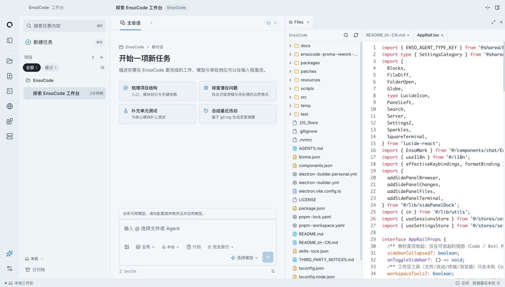
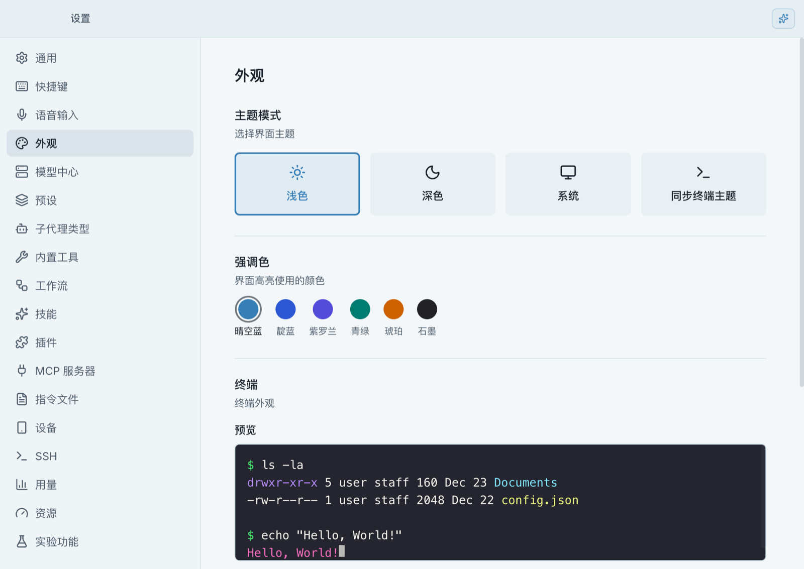
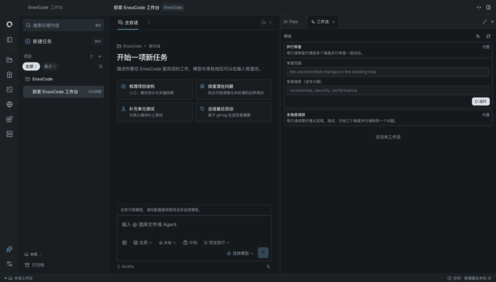

<p align="center">
  
</p>

<h1 align="center">EnsoCode</h1>

<p align="center">
  <b>把项目、模型和 Coding Agent，放进同一个桌面工作台。</b>
</p>

<p align="center">
  本地优先的编程 Agent 工作台，由
  <a href="https://github.com/tingyuxuan123">@tingyuxuan123</a> 独立维护。
</p>

<p align="center">
  <a href="https://github.com/tingyuxuan123/EnsoCode/releases"><b>下载</b></a>
  ·
  <a href="#工作台能做什么">功能介绍</a>
  ·
  <a href="#本地开发">本地开发</a>
  ·
  <a href="https://github.com/tingyuxuan123/EnsoCode/issues">问题反馈</a>
  ·
  <a href="README.md">English</a>
</p>

<p align="center">
  <a href="https://github.com/tingyuxuan123/EnsoCode/releases"></a>
  
  <a href="LICENSE"></a>
</p>

---

<p align="center">
  
</p>
<p align="center"><sub>当前浅色工作台：项目导航、新任务和源码文件并排展示。</sub></p>

## 关于这个版本

本仓库起源于 [J3n5en/EnsoCode](https://github.com/J3n5en/EnsoCode)，现在由我独立维护。在保留 EnsoCode 名称和原项目基础能力的同时，这个版本按自己的使用习惯持续调整界面、交互和开发方向，并使用独立的个人发布通道。**它不是上游官方发行版。**

我希望它首先是一个自己愿意每天打开的工作台：项目和会话切换顺手，模型可以自由选择，任务能够分工，执行过程看得见，最后的改动也方便审查。不必为了完成一件事，在一堆窗口之间来回切换。

技术基础是 Electron、React、TypeScript，以及 [pi](https://github.com/earendil-works/pi) coding agent harness。

## 工作台能做什么

### 对话在中间，工具在手边

项目导航、会话时间线和可停靠的工具面板放在同一个工作区。读文件、看改动、运行终端、打开浏览器时，不用离开正在处理的任务。

- **项目与会话**：按仓库组织工作，不同任务保留各自的对话。
- **文件与改动**：浏览源码，在会话旁审查本次任务或 Git 中的变更。
- **终端与浏览器**：执行命令、预览网页，不必切出应用。
- **外观设置**：浅色 / 深色主题、终端配色、背景图和透明度，按自己的习惯调整。

<details>
<summary><strong>查看外观设置</strong></summary>

<p align="center">
  
</p>
<p align="center"><sub>主题模式、强调色和终端配色实时预览。</sub></p>

</details>

### 模型自己选，已有配置接着用

接入自己的模型供应商和兼容端点，不绑定单一模型服务。模型、技能、MCP 服务和运行时预设都可以按工作需要配置。

- 导入本机 Claude Code、Codex、Cursor 中受支持的配置与历史。
- 在输入框通过 `@` 引用文件和会话，使用技能和斜杠命令。
- 工作时查看当前模型、上下文用量等状态。

### 能分工，也能跟进过程

| 工具 | 适合做什么 |
| :--- | :--- |
| **Subagent** | 把独立的调研、实现、测试或审查交给单独上下文处理。 |
| **Coworker** | 在独立会话中长期协作，随时查看、插话和调整方向。 |
| **Workflow** | 用预设组织可重复的多 Agent 任务，在面板中查看运行进度。 |
| **目标跟踪** | 把任务目标保留在视野里，让 Agent 跨多轮持续推进。 |
| **后台任务** | 单独管理开发服务器、监听进程和耗时命令，不挤占主对话。 |

需要隔离工作目录时，可以使用 Git Worktree。Agent 上下文独立，不代表并行修改同一批文件就不会冲突。

<p align="center">
  
</p>
<p align="center"><sub>深色模式下的工作流面板：配置并行审查，或选择多角度调研。</sub></p>

截图来自隔离的本地预览，不含私人会话或模型凭据，也不展示模型运行结果。

### 改了什么，由你验收

查看 Diff、审批工具操作、排队补充要求，或直接打断正在执行的任务。审批模式支持逐项确认、自动接受编辑和完全放行；Git Checkpoint 可用于回退受支持的改动。

需要离开工位或使用远程机器时，项目也保留了可选的手机伴侣、桌面远程节点和 SSH 项目能力。手机与远程节点配对使用端到端加密，中继转发密文，不读取会话明文。

## 下载与开始使用

**[前往本仓库 Releases →](https://github.com/tingyuxuan123/EnsoCode/releases)**

当前个人发布通道面向 **macOS Apple Silicon**，安装包以 `personal-v*` 预发布版本提供，包含 `.dmg` 和 `.zip`。源码中保留的 Windows、Linux 和 Intel Mac 构建支持，不代表本仓库承诺持续提供这些平台的个人安装包。

1. 从**本仓库**的 `personal-v*` Release 下载安装包。
2. 在设置中接入模型供应商，或导入受支持的本机配置。
3. 添加项目，创建会话。
4. 描述任务，确认执行操作，审查最终改动。

不需要注册 EnsoCode 账号。模型请求发往你配置的供应商或端点，产生的模型费用由对应服务收取。

### 关于个人更新通道

个人版使用本仓库的 `personal-updates` 更新通道。上游安装版不会自动切换过来，首次迁移需要手动安装个人版。切换发行版前，建议备份重要设置和会话。

个人包使用个人签名证书，**未经 Apple Developer ID 公证**，macOS 可能要求额外确认。安装前请核对发行说明和 `SHA256SUMS`，不要全局关闭系统安全保护。

## 本地优先，但不模糊联网边界

| 数据或操作 | 边界 |
| :--- | :--- |
| 会话与设置 | 由应用保存在本机。 |
| 模型凭据 | 由桌面 Main 进程管理，不包含在手机目录中。 |
| 模型请求 | 发送到你配置的供应商或端点，包含完成请求所需的上下文。 |
| MCP 与外部工具 | 根据配置和你授予的权限，可能访问文件或外部服务。 |
| 手机与远程节点 | 按需配对，经中继传输的会话流量采用端到端加密。 |
| 浏览器与联网工具 | 会访问你打开或要求 Agent 使用的网站与服务。 |

本地优先不等于完全离线。请根据自己的隐私要求选择模型供应商、工具和远程服务。

## 本地开发

使用 [`.nvmrc`](.nvmrc) 指定的 Node.js 版本，以及 [`package.json`](package.json) 中固定的 pnpm 版本。

```bash
pnpm install
pnpm dev
```

```bash
# 构建应用代码
pnpm build

# 提交前检查
pnpm typecheck && pnpm lint && pnpm test
```

- [工程开发约定](docs/engineering-guidelines.md)：开发规范、测试要求和分层边界。
- [发布与更新验收](docs/engineering-reference/guides/releasing.md)：个人版由 GitHub Actions 打包和验收，不在本机打包发布。
- [自建中继](packages/relay/README.zh-CN.md)：配对设备所需的可选基础设施。

## 反馈与参与

这个版本的问题和建议，请提交到[本仓库 Issues](https://github.com/tingyuxuan123/EnsoCode/issues)。反馈时尽量附上应用版本、操作系统、复现步骤和脱敏日志，不要上传 API Key、配对密钥或私密会话内容。

这是一个个人维护的项目，开发节奏和功能取舍以维护者的实际使用需求为主，与上游版本不保证同步。较大的改动建议先开 Issue 讨论，PR 请保持目标单一、范围清晰。

## 致谢与许可

感谢 [J3n5en/EnsoCode](https://github.com/J3n5en/EnsoCode) 及其贡献者提供原始项目，也感谢 [pi](https://github.com/earendil-works/pi) 和工作台依赖的开源项目。

本项目使用 [MIT License](LICENSE)，保留原有版权与许可声明。第三方依赖说明见 [THIRD_PARTY_NOTICES.md](THIRD_PARTY_NOTICES.md)。
